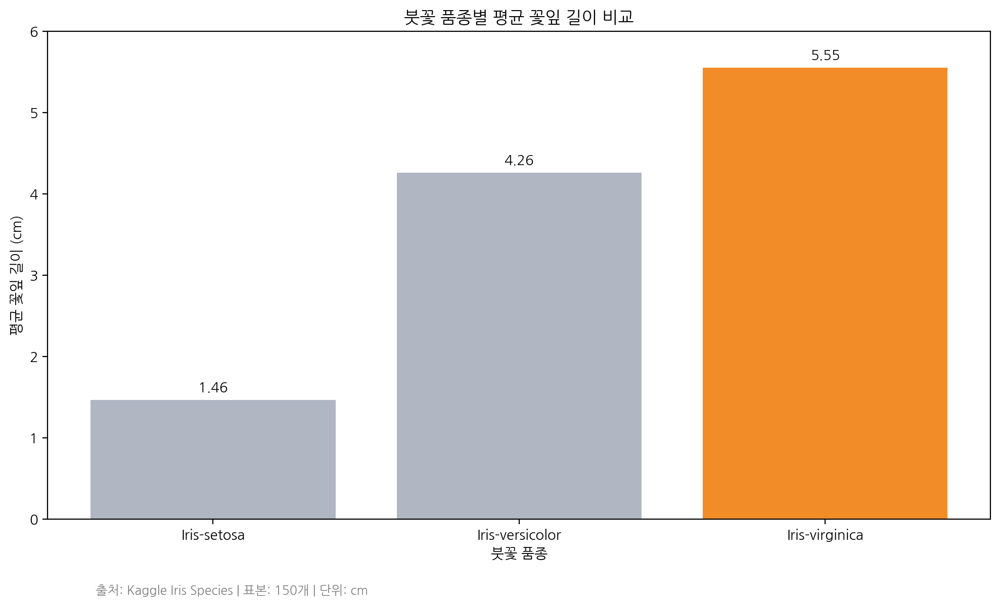
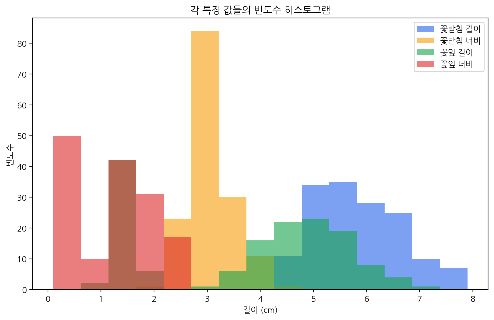
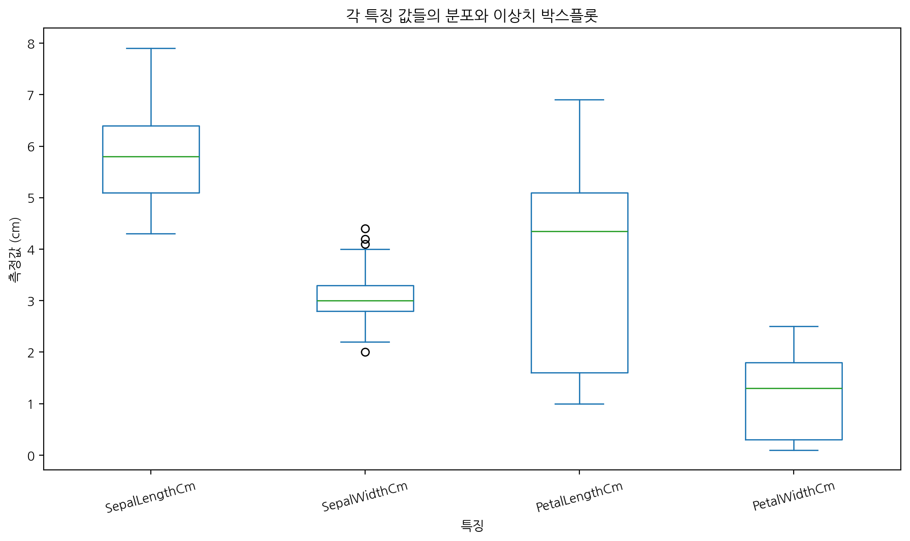

# 🌸 MBC 붓꽃(Iris) 데이터 분석 · 2026.11.09

> **MBC AI 데이터 저널리즘 수업 실습 포트폴리오**  
> 작성: 김형석 (Dominic Kim)  
> 분석 도구: Python · pandas · Matplotlib · Google Colab

## 프로젝트 개요

Kaggle의 **Iris Species** 데이터를 활용하여 붓꽃 세 품종의 꽃받침·꽃잎 측정값을 분석했습니다. 데이터 확인과 전처리, 기초 통계, 조건 검색, 시각화(막대그래프·히스토그램·박스플롯)를 진행하고, **차트별 질문과 해석을 함께 기록**했습니다.

## 데이터 및 분석 기준

- 출처: [Kaggle Iris Species](https://www.kaggle.com/datasets/uciml/iris)
- 입력 파일: `data/Iris.csv` (실습 당시 사용한 파일 이름 `Iris.csv`)
- 표본: **150행** / 원본 열 **6개** (`Id` 포함)
- 품종: Iris-setosa 50개 · Iris-versicolor 50개 · Iris-virginica 50개
- 숫자 측정값(단위 cm): `SepalLengthCm`, `SepalWidthCm`, `PetalLengthCm`, `PetalWidthCm`
- 데이터 품질: 원본 6개 열 기준 결측값 **0개**, `Id` 포함 전체 행 중복 **0개**. `Id` 제외 동일 측정값 여부는 별도로 검토해야 하며 중복을 임의 삭제하지 않습니다.

> **재현 유의:** 이 공유 묶음에는 실제 `Iris.csv`가 포함되지 않았습니다. 실행하려면 Kaggle에서 별도 다운로드하여 `data/Iris.csv`로 저장하세요. 노트북은 Colab의 기존 Drive 경로도 지원하도록 정리했습니다. 패키지의 PNG는 사용자가 실제 Colab에서 생성한 결과이며, 정리본 노트북 자체의 전체 재실행은 아직 확인되지 않았습니다.

## 핵심 분석 결과

| 품종 | 평균 꽃잎 길이(cm) |
|---|---:|
| Iris-setosa | 1.46 |
| Iris-versicolor | 4.26 |
| Iris-virginica | **5.55** |

원본 Colab 출력에 따르면 Iris-virginica의 평균 꽃잎 길이가 가장 길며, Iris-setosa의 약 **3.8배**입니다. 이는 측정된 표본의 품종별 평균 차이입니다.

## 시각화와 질문·해석

### 1. 품종별 평균 꽃잎 길이 · 막대그래프



- **질문:** 세 붓꽃 품종 중 평균 꽃잎 길이가 가장 긴 품종은?
- **해석:** Iris-virginica가 평균 5.55cm로 가장 길었고, Iris-setosa(1.46cm)의 약 3.8배입니다.
- **검수:** 막대 0 기준, 막대별 숫자 라벨, 최고값 강조색, 단위 및 출처 표기 확인.

### 2. 네 측정값의 분포 · 히스토그램



- **질문:** 네 측정값은 어느 길이 구간에 주로 분포하는가?
- **해석:** 꽃받침 길이는 대체로 5~6cm 부근에 분포하며, 꽃잎 너비는 상대적으로 작은 값에 많이 분포합니다.
- **검수:** `Id` 제외, 축 단위 확인, 15개 구간, 네 변수의 반투명 겹침으로 판독이 어려울 수 있음.

### 3. 분포와 이상치 · 박스플롯



- **질문:** 어떤 측정값의 분포가 넓고 통계적 이상치가 나타나는가?
- **해석:** 꽃잎 길이가 넓게 분포하고, 꽃받침 너비에서는 박스플롯 기준의 이상치가 관찰됩니다.
- **검수:** `Id` 제외, 측정값 단위 cm, 중앙값·상자·이상치 표시 확인.

### 4. 꽃받침 길이와 꽃잎 길이의 관계 · 산점도


- **질문:** 붓꽃의 꽃받침 길이와 꽃잎 길이는 어떤 관계가 있는가?
- **해석:** 두 측정값의 상관계수는 0.8718로 강한 양의 상관관계가 나타났다.
- **숫자 검증:** Python `corr()` 계산값과 그래프의 상관계수 표시를 비교했다.
- **라벨 검증:** X축 꽃받침 길이(cm), Y축 꽃잎 길이(cm)를 표시했다.
- **색상 검증:** 파란색 점으로 개별 관측값을 표시했다.
- **주의:** 상관관계는 인과관계를 의미하지 않는다.

## 실습 진행 과정

1. Kaggle `Iris.csv` 로딩과 처음 5행 확인
2. 행·열 크기, 품종별 50개, 결측값·중복값 확인
3. 교재와 열 이름을 맞춘 별도 데이터 `iris_book` 생성
4. 조건 검색 및 품종별 집계
5. Matplotlib·pandas plot으로 차트 3종 작성
6. 한글 글꼴 설정, 숫자·라벨·색상 수정, PNG 저장
7. 각 차트별 **질문 → 결과 해석** 기록

## 프로젝트 파일

```text
MBC_Iris_Analysis/
├── README.md
├── MBC_붓꽃_데이터_분석_20261109.ipynb
├── requirements.txt
├── .gitignore
├── data/
│   └── README.md             # Iris.csv 준비 안내
└── charts/
    ├── 01_iris_bar_chart.png
    ├── 02_iris_histogram.png
    └── 03_iris_boxplot.png
```

## 실행 방법

1. `data/README.md` 안내에 따라 Kaggle에서 `Iris.csv`를 다운로드하여 `data/Iris.csv`로 저장합니다.
2. Python 3 환경에 `pip install -r requirements.txt`로 패키지를 설치하거나 Google Colab에서 노트북을 엽니다.
3. `MBC_붓꽃_데이터_분석_20261109.ipynb`를 위에서부터 실행합니다.
4. `charts/`에 저장된 PNG 3장을 확인합니다.

> 주의: Colab의 기본 글꼴은 한글을 지원하지 않을 수 있습니다. 노트북에는 한글 글꼴 설정이 포함되어 있습니다.

## 데이터 저널리즘 관점과 한계

- 데이터와 차트의 **수치·기간(해당 없음)·표본·출처·단위**를 함께 밝혔습니다.
- 히스토그램에서 네 변수의 막대가 겹쳐 판독이 어려울 수 있으며, 이는 향후 개선 대상입니다.
- 박스플롯의 통계적 이상치는 반드시 잘못된 기록이라는 의미가 아닙니다.
- 붓꽃 측정값의 차이는 **관찰된 상관·분포 차이**로서 품종별 원인관계를 증명하지 않습니다.
- 강사님이 지정한 **GitHub 2개 프로젝트 분석 및 추가 분석 기법 적용 과제**는 본 붓꽃 실습과 별개입니다.

## 실습 기록과 재현 상태

- **확인:** Colab 캡처 및 직접 업로드된 PNG 3장의 제목·범례·색상·수치를 확인했습니다.
- **확인:** 업로드된 원본 `.ipynb` 내부 코드와 출력 결과를 정적으로 검토했습니다.
- **미확인:** 공유용으로 재배열한 이 노트북을 새 환경에서 `Run all`로 재실행한 결과.
- **미포함:** 원본 Kaggle `Iris.csv` 실물(별도 다운로드 필요).


## 2026.11.09 — 데이터 시각화 최종 수정 및 검증

강사님의 지침에 따라 차트의 숫자, 글자(라벨), 색상을 수정하고 결과를 재확인했다.

### 1. 막대그래프 (Bar Chart)

- **숫자:** 붓꽃 품종별 평균 꽃잎 길이 1.46cm, 4.26cm, 5.55cm 직접 표시
- **라벨:** 한글 제목, X축 품종, Y축 평균 꽃잎 길이(cm), 출처 표기
- **색상:** 회색 막대와 주황색 강조 막대 사용
- **검증:** Y축 0부터 시작, 원본 데이터 계산값과 차트 숫자 일치

### 2. 히스토그램 (Histogram)

- **숫자:** 측정값의 길이 구간과 빈도수 확인, 구간 수 15개 설정
- **라벨:** 영어 범례를 꽃받침 길이·너비, 꽃잎 길이·너비로 변경
- **색상:** 파랑·주황·초록·빨강 4가지 색상 적용
- **검증:** 식별 번호(Id)를 제외한 실제 측정값 4개만 사용

### 3. 박스플롯 (Box Plot)

- **숫자:** 중앙값 5.80cm, 3.00cm, 4.35cm, 1.30cm 직접 표시
- **라벨:** X축 측정 항목 4개를 한글로 변경
- **색상:** 네 가지 파스텔 색상과 빨간색 중앙값 선 적용
- **검증:** 중앙값 위치와 숫자 라벨 일치, 꽃받침 너비의 통계적 이상치 확인

### 최종 결과

차트 3개의 수정된 PNG 파일과 Python 분석 노트북을 저장했다. 차트별 질문과 해석을 기록했으며, 화면에서 숫자·라벨·색상 변경 결과를 확인했다.

**참고:** 전체 노트북을 처음부터 끝까지 재실행하는 검증과 히스토그램 구간별 빈도수의 독립 재계산은 별도 확인이 필요하다.